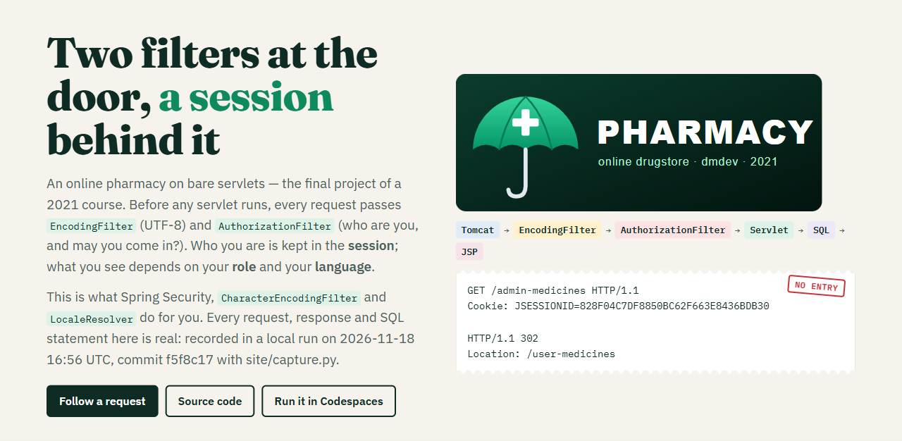
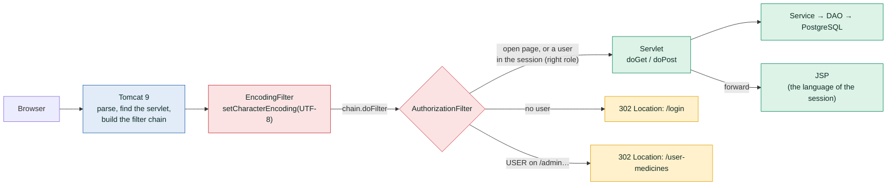
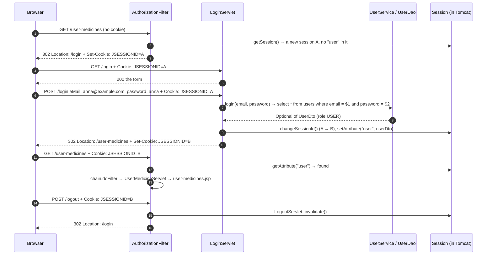
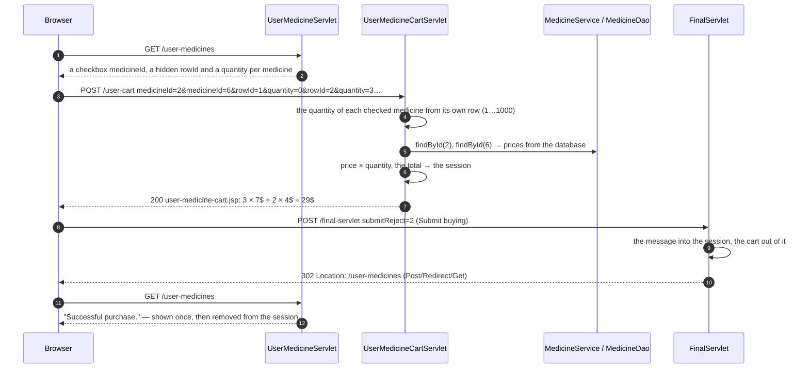
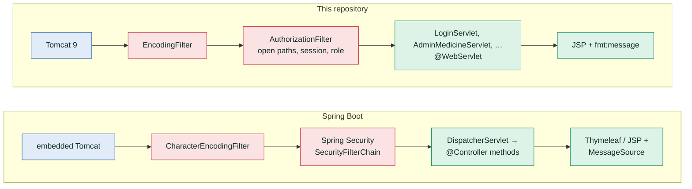
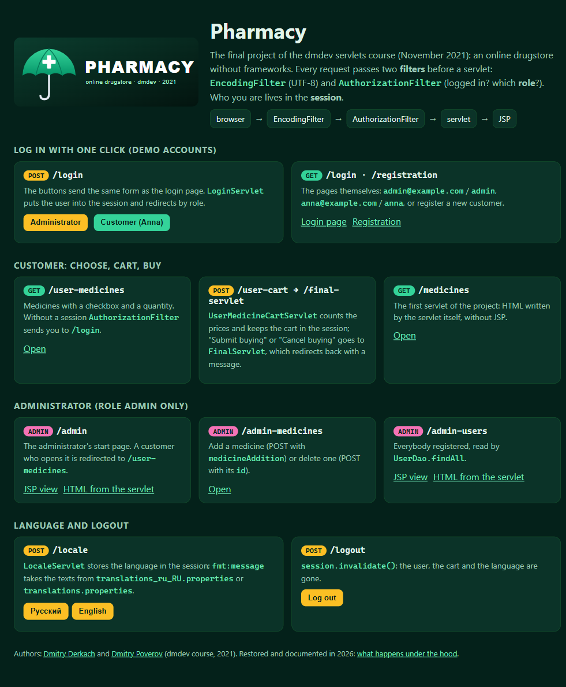
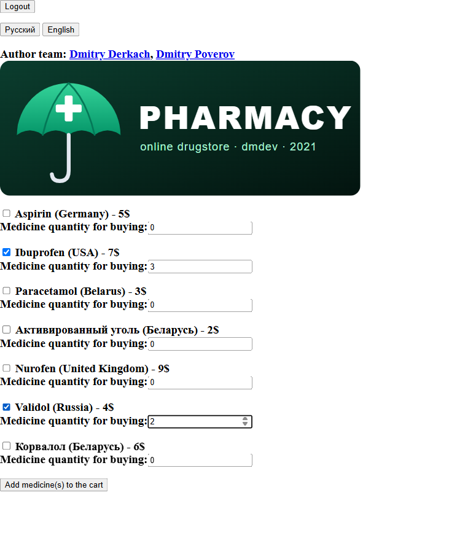
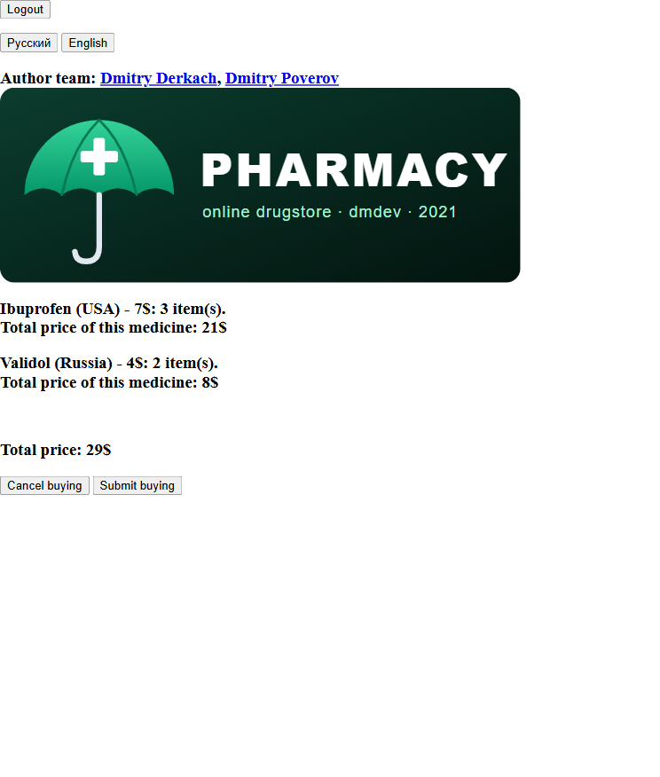
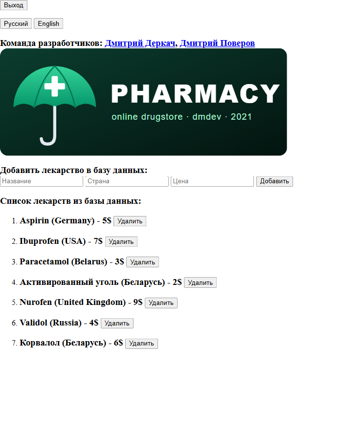

# FinalProjectRepository — an online pharmacy on servlets, filters and JSP (dmdev course, 2021)

[](https://github.com/DmitryDerkach/FinalProjectRepository/actions/workflows/ci.yml)
[](https://codespaces.new/DmitryDerkach/FinalProjectRepository?quickstart=1)

The **final project** of the **dmdev** servlets course, written in **November 2021** in a team of two — me and [Dmitry Poverov](https://github.com/DmitryPoverov), who kept his version in his own repository. It continues [MVC_first_test_application](https://github.com/DmitryDerkach/MVC_first_test_application) (layers, JSP, JSTL) with what a real site needs: **login and logout**, **filters** that stand in front of every servlet, a **session** that remembers who you are, **roles** (an administrator manages the stock, a customer buys), a **cart**, and an interface in **two languages**. Still no framework — exactly the pieces that Spring Security, `CharacterEncodingFilter` and `LocaleResolver` give you later. 3 commits, 2021-11-24 … 2021-11-28.

In 2026 I ran it again, fixed what was broken — first of all, **a customer could open the administrator's pages and delete medicines** — finished the methods left as IDE stubs, made the commented-out code runnable, explained every class, replaced a picture of another company with a drawn logo, and packed everything into **one command**: PostgreSQL and Tomcat 9 in Docker, a fresh database on every run, and 31 JUnit tests, most of them on a real embedded Tomcat. GitHub Actions runs all of it on every push (see [2026 clean-up](#2026-clean-up)).

[](https://dmitryderkach.github.io/FinalProjectRepository/)

**[Pharmacy under the hood](https://dmitryderkach.github.io/FinalProjectRepository/)** — an interactive page that walks 21 real requests through Tomcat, both filters, the servlet, the service, the DAO, the SQL that PostgreSQL received, the JSP and back. It shows where the filter stops a guest or a customer, how the session cookie changes at login and logout, and the Java class Tomcat generated from a JSP with two languages. All of it is recorded from this code by the CI on every deploy.

## Three ways to see it work

| | What you need | What you get |
|---|---|---|
| **[Codespaces](https://codespaces.new/DmitryDerkach/FinalProjectRepository?quickstart=1)** | a GitHub account | a cloud machine in the browser: PostgreSQL and Tomcat start by themselves and port 8081 opens in a new tab. The terminal has every `./run.sh` command |
| **[The page on GitHub Pages](https://dmitryderkach.github.io/FinalProjectRepository/)** | a browser | real recorded requests, responses and SQL, explained stage by stage. Nothing runs: it's a recording |
| **[Your machine](#how-to-run)** | JDK 11+ and Docker | `./run.sh` — everything below, on `localhost:8081` |

Demo accounts (email / password): **`admin@example.com` / `admin`** — the administrator, **`anna@example.com` / `anna`** — a customer. The start page logs you in with one click.

## What's inside — the course path

The project is reconstructed from the three commits and the code (there is no task description in the repository):

| # | Commit (2021) | Topic | Where | What it shows |
|---|---|---|---|---|
| 1 | 11-24 *Inintial commit* | **Layers again**, for a new domain | `MedicineDao`, `UserDao` → `MedicineService`, `UserService` → `MedicineDto`, `UserDto` (Lombok) → `MedicineMapper`, `UserMapper` | The same architecture as in the MVC project: SQL only in the DAO, DTOs for the screen, singletons with `getInstance()`. `MedicineServlet` still writes HTML itself; `Runner` checks the DAO from the console |
| 2 | 11-24 | **Login, registration, roles** | `LoginServlet`, `RegistrationServlet`, `AdminServlet`, `AdminUserServlet`, `AdminMedicineServlet`, `UserMedicineServlet` | The user goes into the session; the redirect depends on the role (`ADMIN` → `/admin`, `USER` → `/user-medicines`); the administrator adds and deletes medicines |
| 3 | 11-24 | **The first filter** | `filter/EncodingFilter` | `@WebFilter("/*")`: UTF-8 for every request in one place, before any servlet reads a parameter |
| 4 | 11-26 *Still working* | **The cart** | `user-medicines.jsp` → `UserMedicineServlet`, `FinalServlet`, `user-medicine-cart.jsp` | Checkboxes and quantities, prices from the database, the cart in the session, "Submit / Cancel buying", messages that live in the session until shown |
| 5 | 11-28 *Final commit* | **The guard filter, logout** | `filter/AuthorizationFilter`, `LogoutServlet` | Every page except login, registration and language needs a user in the session; `session.invalidate()` |
| 6 | 11-28 | **Two languages** | `LocaleServlet`, `header.jsp`, `translations.properties`, `translations_ru_RU.properties` | `<fmt:setLocale>`, `<fmt:setBundle>`, `<fmt:message key="..."/>`: every text of every page in English and Russian; the language is kept in the session |
| 7 | 11-28 | The cart reworked | `UserMedicineCartServlet` (`/user-cart`), `header.jsp` | The cart moves into its own servlet; the header gets the logout button, the language buttons and the authors |

```mermaid
flowchart LR
    A["1 Layers<br/><i>DAO → Service → DTO</i>"] --> B["2 Login, registration<br/><i>user in the session, roles</i>"]
    B --> C["3 EncodingFilter<br/><i>@WebFilter(/*)</i>"]
    C --> D["4 Cart<br/><i>session, PRG</i>"]
    D --> E["5 AuthorizationFilter<br/><i>logout</i>"]
    E --> F["6 Two languages<br/><i>fmt:message</i>"]
    classDef layers fill:#FFF1CC,stroke:#E3A008,color:#0E2B24
    classDef session fill:#E1ECF8,stroke:#2563A8,color:#0E2B24
    classDef filter fill:#FBE3E4,stroke:#C8323B,color:#0E2B24
    classDef lang fill:#DDF3E8,stroke:#0F8A5F,color:#0E2B24
    class A layers
    class B,D session
    class C,E filter
    class F lang
```



The database `pharmacy_database` has two tables, `medicines` and `users`; its 2021 script was never committed, so in 2026 it was restored from the SQL of the DAOs. All comments in the code are in Russian, as I wrote them in 2021; the `Описание (2026)` blocks at the top of every class explain what it does.

## Under the hood

### Two filters in front of every servlet

A servlet filter is a class that Tomcat calls **before** the servlet, for every URL that matches its mapping. Both filters of this project are mapped to `/*`, so every request — a page, a form, even a static file — passes through them. Each filter either passes the request on with `chain.doFilter(request, response)` or answers itself and stops:



**What I wrote in 2021** — `filter/AuthorizationFilter.java` as it was in the *Final commit*:

```java
@WebFilter("/*")
public class AuthorizationFilter implements Filter {

    private static final Set<String> PUBLIC_PATH = Set.of("/login", "/registration", "/locale");

    @Override
    public void doFilter(ServletRequest request, ServletResponse response, FilterChain chain) throws IOException, ServletException {
        var uri = ((HttpServletRequest) request).getRequestURI();
        if (isPublicPath(uri) || isUserLoggedIn(request)) {
            chain.doFilter(request, response);
        } else {
            var prevPage = ((HttpServletResponse) response).getHeader("referer");
            ((HttpServletResponse)response).sendRedirect(prevPage != null ? prevPage : "/login");
        }
    }

    private boolean isUserLoggedIn(ServletRequest servletRequest) {
        var user = (UserDto) ((HttpServletRequest) servletRequest).getSession().getAttribute("user");
        return user != null;
    }
    // ...
}
```

It answers one question — *is anybody logged in?* — and that was the biggest bug of the project: a customer was "somebody", so `/admin-users` showed them every account, and a POST to `/admin-medicines` deleted a medicine. **Added in 2026** — the second question, *which role?* (the `referer` line read the header from the *response*, where it never is, so it always fell back to `/login`; that is what it does now, without the dead code):

```java
// 2026: pages of the administrator - /admin, /admin-users, /admin-medicines
private static final String ADMIN_PATH = "/admin";

if (isPublicPath(uri) || isUserLoggedIn(request)) {
    // 2026: a USER on an administrator page goes to their own page
    if (uri.startsWith(ADMIN_PATH) && !isAdmin(request)) {
        ((HttpServletResponse) response).sendRedirect("/user-medicines");
        return;
    }
    chain.doFilter(request, response);
} else {
    ((HttpServletResponse) response).sendRedirect("/login");
}
```

The start page and the logo are open too (2026) — compared as exact paths, because with `startsWith` the path `/` would open everything: every path starts with `/`.

The order of the two filters: the Servlet specification does not fix the order of filters declared only with `@WebFilter`. Here it doesn't matter — `AuthorizationFilter` reads no parameters, so the encoding is always set before a servlet reads the form. To fix an order, list the filters in `web.xml` (in Spring Boot: `@Order` or `FilterRegistrationBean`).

### Who are you? Login, the session, logout

HTTP forgets everything between two requests. Tomcat gives every browser a cookie `JSESSIONID` — only a key; the data stays in the server's memory under that key. Logging in means putting a `UserDto` into that session; the filter looks for it on every following request:



`changeSessionId()` (2026) gives the session a new id at the moment of login: an id that somebody knew before the login — for example, one planted in a link (*session fixation*) — is worthless afterwards. Spring Security does this by default.

What the session holds for one customer: `user` (the `UserDto`), `lang` (`ru_RU` / `en_US`), `medicines` (the list on the page), and during a purchase the cart — `medicineDtos`, `quantity`, `totalPriceEachMedicine`, `totalPrice`. Tomcat saves sessions to disk when it stops and reads them back on start, so everything stored there must be `Serializable` (2026: `UserDto` and `MedicineDto` were not — a restart logged everybody out).

### The cart



In 2021 the quantities were matched with the checked medicines by their order among the non-zero fields: check Ibuprofen, type 5 into the row of Validol — and you bought 5 × Ibuprofen. Since 2026 every row sends its own `rowId`, so the quantity always comes from the row of the checkbox.

### Two languages

The texts of the pages are not in the JSP: every label is `<fmt:message key="user.email"/>`, and the texts are in two files of the same "bundle":

| Key | `translations.properties` | `translations_ru_RU.properties` |
|---|---|---|
| `user.email` | `Email` | `Эл.почта` |
| `button.cart.submit` | `Submit buying` | `Подтвердить покупку` |
| `error.quantity` | `Quantity of the medicine(s) entered incorrectly.` | `Количество лекарств было введено неверно.` |

The language buttons in the header send `POST /locale lang=ru_RU`; `LocaleServlet` puts it into the session and redirects back. `header.jsp`, pasted into every page, starts with:

```jsp
<fmt:setLocale value="${sessionScope.lang != null ? sessionScope.lang : (param.lang !=null ? param.lang : 'en_US')}"/>
<fmt:setBundle basename="translations"/>
```

— so every `<fmt:message>` below it reads the file of the session's language, and the response gets `Content-Language: ru-RU`. The Russian file is written with `П…` escapes: before Java 9 a resource bundle file was read as ISO-8859-1, so anything else had to be escaped (Java 9+ reads them as UTF-8, JEP 226).

### A JSP is a servlet

**What I wrote in 2021** — HTML with tags (`WebContent/WEB-INF/jsp/login.jsp`, the 2021 version, shortened; `header.jsp` is pasted in by `<%@ include %>`):

```jsp
<%@ page contentType="text/html;charset=UTF-8" pageEncoding="UTF-8" %>
<%@taglib prefix="c" uri="http://java.sun.com/jsp/jstl/core" %>
<%@taglib prefix="fmt" uri="http://java.sun.com/jsp/jstl/fmt" %>
<html>
<head>
    <title>Login</title>
</head>
<body>
<%@ include file="header.jsp"%>
<form action="${pageContext.request.contextPath}/login" method="post">
    <label for="emailId"><fmt:message key="user.email" />
        <input type="text" name="eMail" id="emailId">
    </label>
    ...
</form>
</body>
</html>
```

The browser never receives this file. On the first request Tomcat's JSP engine (Jasper) **generates a Java class from it by itself**, compiles it and runs it like any servlet; nobody writes that class by hand. It lies in Tomcat's working folder (`work/Catalina/localhost/ROOT/org/apache/jsp/WEB_002dINF/jsp/login_jsp.java`):

| In `login.jsp` + `header.jsp` (written by me) | In `login_jsp.java` (generated by Tomcat) |
|---|---|
| `<%@ page contentType="text/html;charset=UTF-8" %>` | `response.setContentType("text/html;charset=UTF-8");` |
| (nothing: a JSP takes part in the session by default) | `session = pageContext.getSession();` — this is why the login page sets `JSESSIONID` for a browser that has no session yet |
| `<%@ include file="header.jsp"%>` | the header's code pasted into the same class before it is generated |
| `<fmt:setLocale value="${...}"/>` | an object of the JSTL class `SetLocaleTag`, `setValue(...)` with the evaluated expression |
| `<fmt:message key="user.email" />` | a method per tag: a `MessageTag` object, `setKey("user.email")`, `doStartTag()` |
| plain HTML | `out.write("<form action=\"");` |

**What Tomcat generated** — a part of the real class from the Tomcat 9 container of `./run.sh web` (shortened; `// ...` marks removed lines, the comments are mine):

```java
// generated by Tomcat (Jasper), not written by hand
public final class login_jsp extends org.apache.jasper.runtime.HttpJspBase ... {

  // Tomcat calls this method for every request to the page - like doGet() of a servlet
  public void _jspService(final javax.servlet.http.HttpServletRequest request,
                          final javax.servlet.http.HttpServletResponse response) ... {
      response.setContentType("text/html;charset=UTF-8");
      // ...
      session = pageContext.getSession();
      // ...
      // <fmt:setLocale> and <fmt:setBundle> of header.jsp
      if (_jspx_meth_fmt_005fsetLocale_005f0(_jspx_page_context))
        return;
      // ...
      out.write("<form action=\"");
      out.write((java.lang.String) PageContextImpl.proprietaryEvaluate("${pageContext.request.contextPath}", ...));
      out.write("/login\" method=\"post\">\n");
      out.write("    <label for=\"emailId\">");
      // <fmt:message key="user.email" /> becomes a method call
      if (_jspx_meth_fmt_005fmessage_005f6(_jspx_page_context))
        return;
      // ...
  }

  private boolean _jspx_meth_fmt_005fmessage_005f6(javax.servlet.jsp.PageContext _jspx_page_context) ... {
      // an object of the JSTL tag class finds the text in the bundle of the page's language
      org.apache.taglibs.standard.tag.rt.fmt.MessageTag _jspx_th_fmt_005fmessage_005f6 = ...;
      _jspx_th_fmt_005fmessage_005f6.setKey("user.email");
      int _jspx_eval_fmt_005fmessage_005f6 = _jspx_th_fmt_005fmessage_005f6.doStartTag();
      // ...
  }
}
```

The [under the hood page](https://dmitryderkach.github.io/FinalProjectRepository/) shows the JSP and the generated class side by side, recorded by the CI on every deploy.

### Why this matters for Spring

Spring doesn't replace any of this; it writes the repetitive parts. A Spring Boot application still runs on Tomcat, still has servlet filters in front of a servlet — and Spring Security **is** such a filter:



| | This repository (2021) | Spring MVC / Spring Boot / Spring Security |
|---|---|---|
| Encoding | `EncodingFilter`: `setCharacterEncoding("UTF-8")` | `CharacterEncodingFilter`, registered by Spring Boot automatically |
| Who may enter | `AuthorizationFilter`: open paths, otherwise `sendRedirect("/login")` | `SecurityFilterChain`: `permitAll()`, `authenticated()`, `formLogin()` |
| Roles | `uri.startsWith("/admin") && role != ADMIN` (2026) | `.requestMatchers("/admin/**").hasRole("ADMIN")` or `@PreAuthorize` |
| Login | `LoginServlet` + `UserDao.findByEmailAndPassword`, the user into the session | `UsernamePasswordAuthenticationFilter` + `UserDetailsService` + `PasswordEncoder` |
| The logged-in user | `session.getAttribute("user")` | `SecurityContextHolder` (kept in the same `HttpSession`), `@AuthenticationPrincipal` |
| Logout | `session.invalidate()` | `.logout()` — `LogoutFilter` |
| Session fixation | `req.changeSessionId()` (2026) | by default |
| Language | `LocaleServlet` → `sessionScope.lang` → `<fmt:setLocale>` | `SessionLocaleResolver` + `LocaleChangeInterceptor` |
| Texts | `<fmt:message key>` + `translations*.properties` | `MessageSource` + `messages*.properties` |
| Form errors | `ValidationException` with text keys (2026) | `@Valid` + `BindingResult` |
| Services, DAO | singletons, `getInstance()` | `@Service`, `@Repository` beans, injected |

## Repository structure

```
run.sh, run.ps1                     # 2026: one command: web / runner / test / reset / stop
docker-compose.yml                  # 2026: PostgreSQL 18 (port 5435) + Tomcat 9.0.123 (port 8081)
.devcontainer/                      # 2026: GitHub Codespaces (JDK 17 + Docker, starts ./run.sh web)
.github/workflows/ci.yml            # 2026: tests + every run.sh mode on Java 11, 17 and 21; publishes the page
site/                               # 2026: the "under the hood" page (GitHub Pages) and capture.py that records it
docs/images/                        # 2026: screenshots for this README
FinalProject/
├── src/
│   ├── filter/                     # EncodingFilter, AuthorizationFilter
│   ├── servlet/                    # Login, Logout, Registration, Locale, Admin, AdminUser, AdminMedicine,
│   │                               #   UserMedicine, UserMedicineCart, Final, Medicine
│   ├── service/                    # MedicineService, UserService
│   ├── dao/                        # Dao<K, T>, MedicineDao, UserDao
│   ├── entity/, dto/, mapper/      # Medicine, User, Role; MedicineDto, UserDto; MedicineMapper, UserMapper
│   ├── exception/, util/           # 2026: ValidationException; ConnectionManager, PropertiesUtil, JspHelper (+ 2026: HtmlUtil)
│   ├── dao_test_package/Runner.java  # the console check of the DAO
│   └── resources/                  # application.properties, translations.properties, translations_ru_RU.properties
├── WebContent/
│   ├── index.html                  # 2026: the start page of the demo ("/" was a 404)
│   ├── images/logo.svg             # 2026: the logo, drawn for this repository
│   └── WEB-INF/jsp/                # login, registration, header, admin, admin-users, admin-medicines,
│                                   #   user-medicines, user-medicine-cart
├── db/                             # 2026: 01_schema.sql, 02_data.sql (restored from the DAO)
├── test/                           # 2026: JUnit 5 tests (DAO on PostgreSQL, the application on an embedded Tomcat)
├── pom.xml                         # 2026: Maven WAR build (the Eclipse layout is kept)
└── mvnw, mvnw.cmd, .mvn/           # 2026: Maven Wrapper
```

## How to run

**Requirements:**

- **JDK 11 or newer** (`java -version` must work, or `JAVA_HOME` must point to a JDK);
- **Docker** with Docker Compose v2 (`docker compose`), running. On Windows/macOS start Docker Desktop first.

Nothing else: Maven, the libraries and the PostgreSQL and Tomcat images are downloaded on the first run (needs internet once).

### One command

From the repository root:

```bash
./run.sh              # Linux, macOS, Git Bash on Windows
```

```powershell
.\run.ps1             # Windows PowerShell
```

This builds the application, starts **PostgreSQL 18** and **Tomcat 9** in Docker, recreates the database (the same data every time), walks through the shop with `curl` — a guest stopped by the filter, a wrong and a right login, the cart, a customer at an administrator page, a medicine with a Cyrillic name, the switch to Russian, the logout — prints the SQL the application sent, and **leaves everything running**: open **<http://localhost:8081/>** in a browser.

All commands (the same for `run.ps1`):

| Command | What it does |
|---|---|
| `./run.sh` or `./run.sh web` | build, reset the database, (re)start PostgreSQL and Tomcat, walk through the shop, show the SQL |
| `./run.sh runner` | reset the database and run the console `Runner`: all medicines, all users, save a user, delete a medicine, find a medicine |
| `./run.sh runner findMedicine` | one step of the `Runner` (`medicines`, `users`, `saveUser`, `deleteMedicine`, `findMedicine`) |
| `./run.sh test` | reset the database and run the JUnit tests (31), Tomcat embedded in the test |
| `./run.sh reset` | recreate the tables and the data |
| `./run.sh stop` | stop and remove the containers and the database |

Example — parts of `./run.sh web`:

```
== curl -i http://localhost:8081/user-medicines   (no session: AuthorizationFilter redirects to the login page) ==
HTTP/1.1 302
Location: /login

== curl -i -d eMail=anna@example.com -d password=wrong http://localhost:8081/login ==
HTTP/1.1 302
Location: /login?error&email=anna%40example.com

== curl -i -c anna.txt -d eMail=anna@example.com -d password=anna http://localhost:8081/login   (USER -> /user-medicines) ==
HTTP/1.1 302
Location: /user-medicines
...
== curl -b anna.txt -d medicineId=2 -d rowId=1 -d quantity=0 -d rowId=2 -d quantity=3 ... http://localhost:8081/user-cart   (3 x Ibuprofen) ==
Ibuprofen (USA) - 7$: 3 item(s). <br> Total price of this medicine: 21$
Total price: 21$
...
== curl -i -b anna.txt http://localhost:8081/admin-medicines   (a USER on an ADMIN page: AuthorizationFilter says no) ==
HTTP/1.1 302
Location: /user-medicines
...
== curl -b admin.txt --data-urlencode name=Анальгин ... -d price=4 -d medicineAddition http://localhost:8081/admin-medicines ==
<p>Medicine saved.</p>
<h3>Анальгин (Беларусь) - 4$

== curl -b admin.txt -H 'Referer: http://localhost:8081/admin-users' -d lang=ru_RU http://localhost:8081/locale, then /admin-users ==
HTTP/1.1 302
Location: /admin-users
<h3>Команда разработчиков:
<h3>Список пользователей из базы данных:</h3>
Id:1, Admin - [admin@example.com] - ADMIN
Id:2, Анна Смирнова - [anna@example.com] - USER
Id:3, Oleg Kovalev - [oleg@example.com] - USER
...
== PostgreSQL log: the SQL the application sent for these requests ==
LOG:  execute <unnamed>: SELECT * FROM users WHERE email = $1 AND password = $2
DETAIL:  Parameters: $1 = 'anna@example.com', $2 = 'wrong'
...
LOG:  execute <unnamed>: select * from medicines where id = $1
DETAIL:  Parameters: $1 = '2'
...
LOG:  execute <unnamed>: insert into medicines (name, price, country_of_production) values ($1,$2,$3)
DETAIL:  Parameters: $1 = 'Анальгин', $2 = '4', $3 = 'Беларусь'
...
== Tomcat is running: open http://localhost:8081/ in a browser (./run.sh stop stops it) ==
```

Note what is **not** in the SQL log: the requests that a filter stopped (the guest, the customer at `/admin-medicines`) never reached a servlet, so they never reached the database.

### In the browser

With everything running (`./run.sh web`), open <http://localhost:8081/> — the start page logs you in as the administrator or as a customer with one click:

| URL | Who | Handled by | What you see |
|---|---|---|---|
| <http://localhost:8081/> | everybody | Tomcat's `DefaultServlet` (`index.html`) | the start page: demo logins, every URL |
| <http://localhost:8081/login> | everybody | `LoginServlet` → `login.jsp` | the login form, the language buttons |
| <http://localhost:8081/registration> | everybody | `RegistrationServlet` → `registration.jsp` | a new customer; errors on the form |
| <http://localhost:8081/user-medicines> | logged in | `UserMedicineServlet` → `user-medicines.jsp` | medicines with checkboxes and quantities → the cart |
| <http://localhost:8081/medicines> | logged in | `MedicineServlet` | the first servlet: HTML written by Java |
| <http://localhost:8081/admin> | ADMIN | `AdminServlet` → `admin.jsp` | two buttons (`?view=servlet` — the list of medicines written by the servlet) |
| <http://localhost:8081/admin-medicines> | ADMIN | `AdminMedicineServlet` → `admin-medicines.jsp` | add and delete medicines |
| <http://localhost:8081/admin-users> | ADMIN | `AdminUserServlet` → `admin-users.jsp` | everybody registered (`?view=servlet` — without JSP) |



The customer's page — every row has a checkbox and a quantity:



The cart, after 3 × Ibuprofen and 2 × Validol:



The administrator's stock in Russian — the same JSP, the texts from `translations_ru_RU.properties`:



### In GitHub Codespaces

Click **[Open in GitHub Codespaces](https://codespaces.new/DmitryDerkach/FinalProjectRepository?quickstart=1)**. The first start takes a few minutes (it builds a machine with JDK 17 and Docker); then `./run.sh web` runs by itself and port 8081 opens in the browser. Every command from the table works in the codespace terminal. Codespaces are free for personal accounts within GitHub's monthly quota; stop or delete the codespace when you are done.

### Without the scripts

```bash
docker compose up -d --wait db           # PostgreSQL on port 5435; creates the tables on the first start
cd FinalProject
./mvnw package                           # tests + target/pharmacy.war (Windows: .\mvnw.cmd ...)
cd ..
docker compose up -d --wait              # + Tomcat 9 with target/pharmacy/ as the ROOT application
docker compose logs db                   # every SQL statement
docker compose down -v                   # stop and delete the database
```

The console `Runner`: `cd FinalProject && ./mvnw -q compile exec:java` (all steps) or `./mvnw -q compile exec:java -Dexec.args=findMedicine` (one step).

To deploy `FinalProject/target/pharmacy.war` to **your own Tomcat 9** (Tomcat 10+ won't load it: it uses `jakarta.servlet` instead of `javax.servlet`), copy it to `webapps/ROOT.war` — the servlets redirect to absolute paths like `/login`, so the application must be the root one.

### Your own PostgreSQL

The settings are in `src/resources/application.properties` (`localhost:5435`, `postgres`/`postgres`). Any of them can be overridden with a system property, without editing the file: `-Ddb.url=jdbc:postgresql://localhost:5432/pharmacy_database -Ddb.user=... -Ddb.password=...` — for Tomcat in `CATALINA_OPTS`, for the tests `./mvnw test -Ddb.url=...`. Create the tables with `db/01_schema.sql` and `db/02_data.sql`.

### From an IDE

- **IntelliJ IDEA:** *File → Open* → `FinalProject/pom.xml` → *Open as Project*; enable annotation processing (Lombok) if asked. The tests and `Runner` run directly when the database is up (`./run.sh reset`). For the web application use `./run.sh web`, or a Tomcat 9 run configuration with the context path `/`.
- **Eclipse** (as in 2021): *File → Import → Maven → Existing Maven Projects*, install Lombok into Eclipse, *Run As → Run on Server* on a Tomcat 9 server with the context root `/`.

### Troubleshooting

| Problem | Fix |
|---|---|
| `docker compose` fails to connect to Docker | Start Docker Desktop (or the Docker service) and wait until it's running. |
| Port 8081 or 5435 is already in use | `TOMCAT_PORT=8090 ./run.sh web` and/or `DB_PORT=5436 ./run.sh web` (PowerShell: `$env:TOMCAT_PORT = "8090"; .\run.ps1 web`). Use the same variables for the other commands: the scripts pass the port to the tests and `Runner` too. |
| `Connection refused` in the tests or the `Runner` | The database is not running: `./run.sh reset` starts it. |
| Every page sends you to `/login` | That's the filter: log in first (the start page has one-click logins). |
| `./run.sh: Permission denied` | `bash run.sh`, or `chmod +x run.sh FinalProject/mvnw` once. |
| `.\run.ps1 cannot be loaded because running scripts is disabled` | Run it as `powershell -ExecutionPolicy Bypass -File .\run.ps1`. |
| Lombok errors (`cannot find symbol getId`) in an IDE | Enable annotation processing / install the Lombok plugin. Maven builds work without it. |

## 2026 clean-up

In 2026 I ran the original code on Tomcat 9 against a database restored from the DAOs, called every URL with correct and wrong input, and fixed what I found. Every change in the code is marked with a `// fix 2026: ...` comment (`<%-- fix 2026 --%>` in JSP, `-- fix 2026` in SQL), additions that are not fixes with `// 2026: ...`; class descriptions in Russian (`/* Описание (2026): ... */`) were added at the top of every class.

**Security:**

- **A customer could do everything the administrator does.** `AuthorizationFilter` only checked that *somebody* was logged in: a customer opened `/admin-users` (every account) and deleted medicines with a POST to `/admin-medicines`. Now the `/admin…` pages need the role `ADMIN`; a customer is sent to `/user-medicines`.
- **Names were not escaped:** a medicine or a user name with HTML (`<script>…</script>`) ran in the browser of everybody who opened the list — the administrator's pages, the shop, `/medicines`. Now `<c:out>` / `fn:escapeXml` in the JSP and `HtmlUtil.escape` in the servlets that write HTML themselves.
- **The session id now changes at login** (`changeSessionId()`), against session fixation.
- `LocaleServlet` redirects only to a path from the `Referer` header, never to another site.

**Bugs fixed:**

- **Hard-coded `http://localhost:8080`** in three redirects (after a purchase, a cancelled purchase, a wrong cart) and in the registration link: on any other port or server the shop sent you to another application. Now paths inside the application.
- **The cart:** quantities were matched with the checked medicines by order, not by row (see [The cart](#the-cart)); no medicine checked → `NullPointerException`; a quantity like `abc` or an empty field → `NumberFormatException`; a negative quantity gave a **negative total (−70$)**; a deleted medicine appeared as `() - 0$`; opening `/user-cart` without a cart → `JspTagException: 'end' < 0`. All of these are now the form's message "Quantity of the medicine(s) entered incorrectly"; the quantity is 1…1000. After a purchase the cart is cleared.
- **"Purchase was rejected" never appeared:** the message was put into the request (`req.setAttribute`), and the redirect that followed is a new request. Now in the session, like the "successful purchase" message. `/final-servlet` without a button was a `NullPointerException`.
- **The administrator's forms answered 500:** a price `abc`, an empty price, a delete without an `id` (`NumberFormatException`); blank names were saved. Now a message on the page; the price is a whole number 0…1 000 000. The result of the last action was shown again on every visit; the messages ("Saved", "Successfully deleted") were English strings in any language — now translated.
- **Registration answered 500** for an email that was already registered (the `unique` constraint) and for a form without fields (`not null`); empty fields were saved. Now `UserService` checks the form and `registration.jsp` shows every error in the language of the page, keeping what was typed. After a registration the login page says so.
- **A failed login redirected to `/login?error&email=null`:** the servlet read the parameter `email`, the form sends `eMail`. Now the email is URL-encoded and written back into the field.
- **The language switch** appended `?lang=…` to the address on every click (`/login?lang=ru_RU?lang=en_EN`), and the English button sent `en_EN`, a language that doesn't exist. Now the address stays as it was (the language is in the session) and the button sends `en_US`.
- **`MedicineDao.findById`** returned an "empty" `Medicine` (`id=0, name=null`) instead of `Optional.empty()` for an unknown id; `MedicineService` called `get()` on it.
- **A Tomcat restart logged everybody out and emptied the carts:** Tomcat saves sessions to disk when it stops, and `UserDto` / `MedicineDto` were not `Serializable` (`NotSerializableException` in the log). Now they are.
- **The lists came in a random order** after any change (no `order by`).
- **`/` answered 404** for everybody; there is now a start page with one-click demo logins.
- **The DAO stubs were finished:** `UserDao.findById` (returned `null` instead of an `Optional`), `UserDao.delete`, `UserDao.update`, `MedicineDao.update` were IDE stubs (`// TODO Auto-generated method stub`).
- **Dead code restored:** the first versions of `AdminServlet` and `AdminUserServlet` that wrote HTML themselves (`/admin?view=servlet`, `/admin-users?view=servlet`) and every commented-out step of `Runner` (`./run.sh runner [step]`). The commented-out first versions of the JSP pages (Russian texts, before the translations) are kept as comments: they show the same pages as the translated versions below them.
- **Personal and environment data:** the local database login `dmitry_derkach` / `1234` → the `postgres` / `postgres` container; the test address `123@hemk.com` in `Runner` → `tom@example.com`. The old values stay in the Git history.
- **The picture in the header** was the logo of another company (from a video game), loaded from `pbs.twimg.com`; it is replaced with a logo drawn for this repository (`WebContent/images/logo.svg`). The link to my teammate's repository `DmitryPoverov/Pharmacy`, which no longer exists, now leads to his profile.

**One command and tests:**

- **Maven** (`pom.xml`, WAR packaging, the original Eclipse layout `src/` + `WebContent/` kept) + Maven Wrapper instead of an Eclipse project with jars copied into `WEB-INF/lib`: `lombok.jar` (1.18.22 → 1.18.48; it was deployed with the application, now only used at compile time), `postgresql-42.2.18.jar` (→ 42.7.14), `jstl-1.2.jar`. Tomcat 8.5 is end-of-life; the project now runs on **Tomcat 9.0.123** (the newest line with the same `javax.servlet` API).
- **The database in the repository:** `db/01_schema.sql` and `02_data.sql`, restored from the SQL of `MedicineDao` and `UserDao` (the 2021 tables were never committed), with demo medicines and three fictional users. The table `medecines` (a typo, in the DAO too) is now `medicines`.
- `run.sh` / `run.ps1` with the modes `web`, `runner`, `test`, `reset`, `stop`; PostgreSQL and Tomcat in Docker (`docker-compose.yml`, ports 5435 and 8081, so that the other course repositories can run at the same time), the database reset before every run; PostgreSQL logs every statement, so `./run.sh web` shows the SQL behind each step.
- **JUnit 5 tests** (31): the DAOs and the services on the real database; the whole application on an **embedded Tomcat** with the real filters and JSP compilation — the filter for guests and customers, logins and session ids, the cart with every wrong form, the administrator's forms, registration, escaping, both languages (no `???key???` on any page), and the session attributes surviving serialization, and the same keys in both translation files. I checked with mutations that the tests fail when any of the fixes is reverted (56 mutations, one per fix).
- **CI:** GitHub Actions runs the tests and every `run.sh` mode on Java 11, 17 and 21, and checks the answers with `curl`.
- **Codespaces** (`.devcontainer/`) and the **"under the hood" page** on GitHub Pages: the CI records real requests, responses, SQL and the generated JSP class from this code on every deploy (`site/capture.py`).
- **Housekeeping:** removed the Eclipse project files (`.classpath`, `.project`, `.settings/`, `.externalToolBuilders/`, `.tern-project`) and the jars from Git; the registration tab was titled `Title`.
- **Typos fixed** in identifiers (`medecines` → `medicines`, `buildMedecine` → `buildMedicine`, `listOfMedecine`, `listOdMedicine`, `findbyId` → `findById`, `responce` → `response`, `Succsessfuly` → `Successfully`, `mapFromUserDtoToUser` → `mapFromUserToUserDto` — it maps the other way round) and in texts (`добавляения` → `добавления`, `отменена .` → `отменена.`).

The rest of the code is intentionally left as we wrote it in 2021.

### Known issues (left as-is)

- **Passwords are stored and compared as plain text**, and the `UserDto` in the session carries the password too. A real shop hashes them (Spring: `PasswordEncoder`). Don't reuse a real password in the demo.
- **"Submit buying" saves nothing:** the project has no table of orders and doesn't change any stock — the purchase is a message.
- **No connection pool:** every DAO call opens a new database connection. Fine for a demo, slow under load.
- The servlets redirect to absolute paths (`/login`, `/admin`), so the application works only as the root application of Tomcat (context path `/`), as it was deployed from Eclipse.
- The administrator's forms answer with a forward, not a redirect: reloading the page after "Add" sends the form again.
- The two filters have no fixed order (both are `@WebFilter("/*")`); it doesn't matter for this code — see [Two filters in front of every servlet](#two-filters-in-front-of-every-servlet).
- `admin-users.jsp` has a form with hidden fields and no button; `UserMedicineServlet` sets a request attribute `request` that no page reads; `MedicineMapper` builds a medicine in a roundabout way (a `try`/`catch` that never catches) — explained in a comment, left as written.

## Credits

The logo (`WebContent/images/logo.svg`) was drawn for this repository in 2026. The medicines and users in `db/02_data.sql` are demo data; the people are fictional. Team of the 2021 project: Dmitry Derkach and [Dmitry Poverov](https://github.com/DmitryPoverov).
